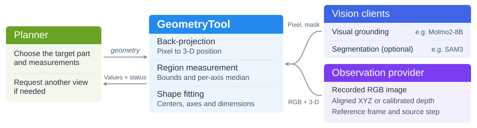

.. _geometry-toolkit:

Geometry Toolkit
================

``GeometryTool`` is a general-purpose tool for geometric perception. Through
``geometry``, the planner describes the object and the part to measure. The
tool computes a position, direction or size using calibrated views of the same step.

Design Purpose
--------------

A robot may need the position, orientation or size of a particular part
to plan its next action. A 3-D observation gives the position of a
visible surface point directly. Estimating a part's center, axis or
radius usually requires several points along an edge or across a curved
surface. ``GeometryTool`` gives robot applications a common interface for
these measurements. The planner describes the target and the quantities
it needs. The tool starts with the named camera and consults the other
calibrated views recorded at that step when necessary. The planner receives
the supported measurements and the reasons for any missing fields.

.. _geometry-module-design:

Module Design
-------------

The planner calls ``geometry`` with a target description in ``query`` and
a camera name in ``camera``. The tool reads the primary view first and locates
each part the measurement needs. A visual model selects a pixel on the
part in the color image. The tool uses back-projection to find that
pixel's 3-D position in the reference frame.

In object-first mode the tool verifies the target's identity before
returning a surface point. It can use RGB-D to delimit the object, or
use an injected segmenter such as SAM3 for a candidate or a specific
part. Valid 3-D points in the region support bounds and shape fits.
If the recorded views cannot resolve the target, the planner chooses
the next task action.

         view supplies 3-D data. GeometryTool returns measurements and
         status to the planner.
   :align: center
   :width: 100%

.. _geometry-prompt-design:

Point-Selection Prompt
~~~~~~~~~~~~~~~~~~~~~~

The planner's ``query`` should identify one object by its appearance and
spatial relations, and name the part to measure. For fitted quantities,
the tool adds the corresponding part description, such as a sealed top
lid or an inner upper rim, before asking Molmo2-8B to select a point.

The Molmo service's ``geometry`` mode requests one visible material point
on that exact part. A rim needs rim material; a lid needs its top face.
An empty center, interior floor or side wall cannot substitute for that
part. The model selects only a 2-D point; subsequent computation estimates
geometric centers and dimensions. If the object or part is not visible,
or similar instances cannot be distinguished, the model should report
no match. The tool leaves that part unknown without reading 3-D coordinates
or calling the segmenter for that point. If none of the requested results
can be computed, it returns ``insufficient_evidence``.

The service scales Molmo2's 0–1000 coordinates by the original image width
and height to produce ``(col, row)`` pixels, clamping the right and bottom
image edges to the last pixel. The tool converts these to array order
``[row, col]`` and verifies the original resolution before reading the
3-D observation. No parseable single point means no coordinates. Flash
keeps its separate default manipulation-point prompt.

.. _processing-flow:

Choosing a Measurement
~~~~~~~~~~~~~~~~~~~~~~

``measurement`` defaults to ``surface_point``, which returns the 3-D
coordinates of one visible point on the target surface in ``world_xyz``.
With ``visible_region``, ``visible_bounds_xyz`` gives the range of valid
3-D points in the visible region along each axis, and ``world_xyz`` gives
the median on each axis. To measure a part's center, orientation or size,
list 1 to 10 quantities in ``required_geometry``. The tool fits shapes to
the 3-D points and returns each result under ``geometry``.

.. list-table:: Measurement Methods for Different Objects
   :header-rows: 1
   :widths: 16 44 40

   * - Object
     - Observation needed
     - Method and result
   * - Any object
     - A visible surface point with valid 3-D coordinates.
     - ``surface_point`` returns the 3-D position of that point directly.
   * - Cube
     - 3-D points along all four edges of the top face and near each corner.
       Supply the camera pose so the tool can check for occlusion at the edges.
     - Request ``rectangle_center`` to fit a rectangle and return the
       center of the top face.
   * - Cup with a circular rim
     - A long enough arc of the rim with valid 3-D points along its edge.
     - The tool fits a circle to the rim points. ``rim_center`` gives the
       center of the opening and ``rim_radius`` gives its radius.

.. _request-and-result-contract:

Measuring a Cup
~~~~~~~~~~~~~~~

Suppose there is one cup with a circular rim on the table. We want to
know how wide the opening is and how tall the cup is. We can calculate
the rim diameter from its radius, so the planner requests ``rim_radius``
and ``height``. In this example the camera is called ``table_camera``.
Omitting ``step`` uses its default of ``-1``, the latest recorded
observation from that camera.

.. code-block:: json

   {
     "query": "the cup on the table",
     "camera": "table_camera",
     "required_geometry": [
       "rim_radius",
       "height"
     ]
   }

.. list-table::
   :header-rows: 1
   :widths: 20 43 37

   * - Quantity
     - What the view must show
     - What the tool returns
   * - ``rim_radius``
     - A long enough arc of the circular rim with valid 3-D points along
       its edge.
     - The radius of the fitted circle in meters. ``radius`` is another
       name for the same quantity.
   * - ``height``
     - Enough of the rim and bottom edges to fit two distinct circles on
       a common axis. If the wall can also be fitted, its axis must agree
       with both ends and the visible wall must lie between them.
     - The distance between the two circle centers in meters.

Suppose a view from above shows only the rim clearly and the fit gives a
radius of about 4 cm. The following excerpt illustrates the result.

.. code-block:: json

   {
     "status": "partial",
     "geometry": {
       "rim_radius": {
         "value": 0.04,
         "unit": "m",
         "evidence_status": "inferred"
       },
       "height": {
         "value": null,
         "evidence_status": "unknown",
         "reason": "both_consistent_end_boundaries_required"
       }
     }
   }

Here ``partial`` means that one of the two quantities has a value. Doubling
the radius gives a rim diameter of about 8 cm. The height is ``null``
because this view lacks a bottom edge to pair with the rim. If all values
are present, check ``fit_accepted`` and ``warnings`` for each field. A
returned estimate can carry a warning. When the recorded views support
none of the requested results, the planner receives ``insufficient_evidence``.

Surface-point and visible-region results are marked ``measured``. Fitted
values are marked ``inferred``. For each fitted field, ``definition`` and
``unit`` explain the value, and ``world_frame_id`` and ``source_step``
identify the reference frame and recorded step. ``assumptions`` and ``quality``
record the shape assumptions and fit diagnostics. ``source_parts`` lists the
parts used. Follow ``source_refs`` to find the masks, 3-D points and fit
records saved at the original step in the shared ``EnvState``.

.. _observation-contract:

Camera Observations
~~~~~~~~~~~~~~~~~~~

The robot application implements ``get_observation(*, camera, step)`` on its
``ObservationProvider`` to return a ``GeometryObservation``. It defines the
camera names. The resolved ``step`` identifies an existing record in the
shared ``EnvState``. Each ``world_frame_id`` must consistently identify the
same reference frame.

Each observation needs an original-resolution RGB image (``rgb``, an
H × W × 3 ``uint8`` array) and at least one of two sources of aligned 3-D data.

- With a point map, supply ``world_xyz``. This H × W × 3 array gives each
  pixel's position in meters in the reference frame.
- With a depth map, supply optical-axis depth in meters (``depth_m``), the
  3 × 3 pinhole camera matrix (``intrinsics``) and the rigid 4 × 4 transform
  from camera to reference frame (``camera_to_world``). The tool uses these
  to compute the 3-D coordinates. Camera Z points forward. The application
  defines the orientation of the reference frame.

LIBERO, RoboDojo and Franka look up a pixel's 3-D position with
``back_project``. RoboCasa365 uses ``back_project_batch`` and RoboTwin
uses ``sample_world_xyz``. To connect ``GeometryTool``, the application's
``ObservationProvider`` supplies the full RGB image together with the
corresponding data below.

.. list-table:: Sources of 3-D Data by Platform
   :header-rows: 1
   :widths: 23 38 39

   * - Platform
     - Source of 3-D data
     - What to supply to the geometry tool
   * - MuJoCo / :doc:`LIBERO <../simulators/libero>` and
       :doc:`RoboCasa365 <../simulators/robocasa>`
     - Both environments use robosuite and record world-coordinate maps
       by camera and step.
     - Supply the map as ``world_xyz``. Its pixels and resolution must
       match the RGB image.
   * - SAPIEN / :doc:`RoboTwin <../simulators/robotwin>`
     - RoboTwin uses the camera intrinsics and pose to convert depth in
       meters into a world-coordinate map.
     - Use the map from that camera and step for ``world_xyz``. You can
       also pass the matching depth image as ``depth_m``.
   * - Isaac Sim / :doc:`RoboDojo <../simulators/robodojo>`
     - RoboDojo builds a world-coordinate map from the head or wrist
       camera's depth image and calibration.
     - Supply ``world_xyz`` for that camera and step. You can also supply
       the depth image as ``depth_m``.
   * - Real robot / :doc:`Franka <../real_world_robots/franka>`
     - RGB-aligned depth and camera calibration. A wrist camera also needs
       the end-effector pose at the time of capture.
     - Supply ``depth_m``, ``intrinsics`` and the camera-to-base transform
       as ``camera_to_world``.

.. dropdown:: Valid Points and Optional Observation Data

   Observation arrays are copied into a read-only snapshot. Valid points need
   finite coordinates. If optical-axis depth is supplied or can be derived
   from the camera pose, it must also be finite and positive. Supplied depth
   is checked even when a point map is present. An optional boolean ``valid_mask``
   can exclude additional pixels. A point at the reference origin follows the
   same validity rules.

   The camera pose can orient a plane normal. When cleaning rim or wall
   points, the tool attempts to identify and remove a background plane only
   if the observation supplies an explicit ``up_direction`` in the reference
   frame. Use ``source_refs`` to identify the source of the observation.

.. _responsibilities-and-initialization:

Registering the Tool
~~~~~~~~~~~~~~~~~~~~

Prepare the shared ``EnvState``, the observation provider and a ``MolmoClient``
initialized outside the tool. For object-first measurement, wrap its
``native`` point mode in ``LocalPointAgent`` and inject that as ``grounder``.
The Molmo service loads existing Molmo2-8B weights through ``MOLMO_CHECKPOINT_PATH``
and provides both pointing and identity checks. The part-first evaluation
path uses the separate ``geometry`` point mode.

Inject the application's SAM3 client as ``segmenter`` for part masks and
segmentation fallback. With ``region_source="depth"``, a verified RGB-D
region can support surface, extent and whole-object measurements on its
own. Part fits that require a missing segmenter remain unknown.

The following code registers the instance's ``geometry`` method with an
existing ``toolkit`` and binds its cancellation check at dispatch.

.. code-block:: python

   from functools import partial

   from rpent.robots.components.molmo_client import MolmoClient
   from rpent.utils.rpc import make_rpc_client
   from toolkits.geometry.geometry_tool import GeometryTool
   from toolkits.geometry.local_point_agent import LocalPointAgent

   grounder = LocalPointAgent(
       MolmoClient(make_rpc_client(molmo_endpoint), point_mode="native")
   )
   geometry_tool = GeometryTool(
       state=state,
       observations=observations,
       grounder=grounder,
       segmenter=segmenter,
       region_source="depth",
       segment_fallback=segmenter is not None,
       model="Molmo2-8B",
   )
   geometry = geometry_tool.geometry
   toolkit.add_tool(
       geometry.with_handler(
           partial(geometry, check_cancelled=toolkit.raise_if_cancelled)
       )
   )

See :doc:`interfaces` for toolkit registration and dispatch.

Limits and Runtime Verification
-------------------------------

Occlusion, missing depth or a region that mixes several surfaces can
leave a measurement unknown. Before comparing two views, check that
the target, part definition and reference frame match. Measure again
after the object moves. Combining views into a model of the whole object
or its interior requires a separate reconstruction step. Fit residuals
describe how closely the points match the chosen shape. Actual measurement
error requires an independent measurement for comparison.

Errors while reading an observation, calling a model or saving evidence
return ``status="error"``. If a request omits the required ``camera``, the
toolkit returns an argument error with ``error`` and ``errors`` before
calling the tool.

With the test dependencies installed, run the offline checks from the
repository root.

.. code-block:: bash

   python -m pytest tests/unit_tests/toolkits/geometry \
     tests/unit_tests/rpent/robots/components/test_molmo.py -q

These checks use synthetic observations and substitute model services.
They exercise tool dispatch, coordinate conversion, segmentation retries,
cancellation and part fitting.

.. _geometry-libero-evaluation:

LIBERO Geometry Evaluation
--------------------------

The standalone entry point ``python -m toolkits.geometry.evaluation.experiment``
covers 80 cases and 160 target-part measurements using only the initial
``agentview`` frame. It captures observations, calls GeometryTool, transforms
fixed model reference points using the same-frame object poses, and computes
3-D Euclidean position errors. It performs no robot actions or additional
views and leaves the existing LIBERO runtime unchanged.

``collect``, ``build-truth``, ``infer`` and ``evaluate`` handle capture,
reference generation, inference and error evaluation; use ``--help`` for
each stage's arguments. Live experiments require LIBERO Pro, rendering,
existing Molmo2-8B and SAM3 services. ``infer`` connects through
``--molmo-endpoint`` and ``--sam3-endpoint``, initializing the clients outside
the tool before injection. ``infer --replay`` reuses frozen selections and
masks without contacting model services.

``collect`` saves the RGB-D, calibration and independent reference snapshots
needed as evaluation inputs. By default, ``infer`` retains only per-request
predictions in ``results.jsonl`` and run metadata in ``run_manifest.json``;
temporary tool diagnostics are removed after each case. Add
``infer --save-evidence`` to keep point clouds, masks, overlays and detailed
tool results in per-case directories. For live inference, this also records
point selections and segmentation in ``perception/`` for later
``infer --replay`` runs.

This baseline reruns all 80 cases and 160 measurements with the GeometryTool
source published at commit ``699fa46``. It replays frozen ``step 0 / agentview`` RGB-D,
visual selections and SAM3 masks. No previous predicted coordinates are
combined into this run, and no fresh visual-model inference is performed.

The results below belong to that frozen-input baseline, not an evaluation
with fresh Molmo2-8B selections.

Each evaluation request measures one part center. A computed estimate that
fails quality checks returns ``status="warning"``, ``fit_accepted=false`` and
``warnings`` describing unverified physical boundaries, anchor disagreement
or other unmet checks. The quality thresholds are unchanged; an uncomputable
quantity remains ``null``. Warning coordinates are included in the error
comparison, but have not passed quality checks and provide no calibrated
error bounds.

.. list-table:: Frozen-Input Position Errors
   :header-rows: 1

   * - Group
     - Returned / All Requests
     - Mean (mm)
     - Median (mm)
     - Maximum (mm)
   * - All
     - 160/160
     - 21.329
     - 2.453
     - 378.348
   * - Accepted
     - 18/160
     - 2.233
     - 2.342
     - 3.143
   * - Warning
     - 142/160
     - 23.749
     - 2.498
     - 378.348

Errors include only evaluable requests with returned coordinates. Coverage
also counts refusals, failures and unrun requests.

Keep captures, predictions and generated reports outside the source checkout.
After capture, reference generation and inference, set ``GEOMETRY_RUN_DIR``
to that experiment directory and evaluate from the repository root:

.. code-block:: bash

   export GEOMETRY_RUN_DIR="$HOME/rpent-runs/geometry-evaluation"
   python -m toolkits.geometry.evaluation.experiment evaluate \
     --predictions "$GEOMETRY_RUN_DIR/predictions/results.jsonl" \
     --truth "$GEOMETRY_RUN_DIR/truth.json" \
     --output "$GEOMETRY_RUN_DIR/report"

``evaluate`` writes only a concise ``report.md`` with the coordinate return
rate, mean, median and maximum position errors overall and by fit quality,
per-target statistics, and provenance. Per-request predictions remain in
the input ``results.jsonl``. The output directory must be new or empty.

Local object-first RGB-D measurement (experimental copy)
--------------------------------------------------------

Pass a local :class:`MolmoClient` configured with ``point_mode="native"`` to
``LocalPointAgent`` and inject it into ``GeometryTool``. Injecting this agent enables whole-object pointing by default.
The Pydantic AI agent validates the pixel and image size produced by the local
Molmo model. It runs without a hosted language model. The caller supplies
calibrated metric observations and an up direction. The ``geometry`` tool uses
the point to select a depth component above a measured support surface.
``region_source="depth"`` runs without SAM3. The hybrid mode can also use an
injected SAM3 object mask and a connected plane around the material pixel.

``rim_extrema`` returns left, right, near, and far points on the fitted
inner-rim circle. ``top_corners`` returns far-left, far-right, near-left,
and near-right top-face corners in the camera frame. ``top_size`` returns
the longer and shorter side lengths. ``object_height`` reports the visible
metric extent along the supplied up direction. ``supported_height`` estimates
full height when a nearby support plane and contact are observed.
``height_above_support`` measures the distance along the up direction from
that plane to the highest observed surface, including any gap below the object.
Rectangular measurements use the observed top edges and connected side walls.
A clipped roof can support a center when its wall provides the missing extent.
Full side lengths and corners require visible limits on both axes.
If the view is nearly diagonal and two corners differ in depth by less than
the measured spatial resolution can distinguish, ordered corners stay unknown.
The center and side lengths can still be returned.
``cuboid_corners`` reports the top four vertices followed by the matching
bottom four when an upright rectangular face agrees with a contacting
support plane. The lower vertices carry the vertical-side assumption.

Explicit light or dark descriptions can resolve nearby
depth components when their brightness distributions are distinct.
For a cube or box described by a single chromatic color, the tool compares
color contours across the image, measures the top footprint and checks depth
at its perimeter. A cube also needs compatible side lengths. Multiple
matching boxes require further observation.
A separate patch of the requested color behind an occluder can also make the
target ambiguous, even when its depth samples cannot support a second box fit.

Before reporting a measurement, the local model examines the selected material
and a close-up from the original frame. Poorly resolved material, conflicting
identity evidence, and competing indistinguishable instances can produce
``insufficient_evidence``. The result states which evidence is missing and returns control to the planner. The same check covers surface points, visible
regions and fitted quantities. An accepted surface pixel belongs to the
verified region. An occluded box can support a material point while its full
face remains unknown.

For a short category name, the model also names the isolated material without
seeing the requested name. For appearance-only descriptions, the name must support the object class and the isolated material
must also support the stated appearance. For a well-resolved cutout it cannot name, the
model may name a tight crop with surrounding pixels, then point again on the
isolated material. A conflicting name requires another observation.
For a partly covered colored box, the measured material must include a planar
side. A second point on the isolated material must map back into that region.

When a query names a multicolour package, the local model reads the product
from the measured material without being given the target name. For an open
vessel, depth samples inside the rim must show a cavity. A second visible
cavity of similar appearance can leave a plain vessel description ambiguous.
The input contract
contains calibrated RGB-D, an up direction, the target description and the
requested fields. Object dimensions, poses and reference models belong to the
separate scoring process.

A provider may implement ``additional_observations(primary)`` to enumerate calibrated
views of the same recorded step in a common metric frame. A latest-step request pins
that step once. Geometry tries another camera only if the first view leaves a
measurement unresolved. The tool selects the initial point from the target
description. A surface measured in one camera can guide the search in another
when its projection agrees with the observed depth. The second view verifies
the target identity. Combining fields requires evidence of overlapping material.
Directional measurements keep the first camera's axes. Fields record their source
camera and step. For descriptions such as “bowl between the plate and the ramekin”,
the isolated material is checked as a bowl and the scene supplies the relation.

The checklist uses a local Molmo RPC endpoint or an Apple Silicon MLX checkpoint.
Use ``--first-view-only`` to measure primary-camera performance separately.

.. code-block:: bash

   python -m toolkits.geometry.evaluation.experiment infer \
       --inputs "$GEOMETRY_INPUTS" --output "$GEOMETRY_OUTPUT/live" \
       --mlx-checkpoint "$MOLMO_MLX_PATH" --save-evidence

With a local evidence database produced by
``toolkits.geometry.evaluation.stage_sensors``, the public tool can be rerun
on the original camera frames, for example:

.. code-block:: bash

   python -m toolkits.geometry.evaluation.local_experiment \
       "$GEOMETRY_INPUTS" "$GEOMETRY_OUTPUT/visual.sqlite" \
       "$GEOMETRY_OUTPUT/centers.jsonl" --region depth --extra-features \
       --identity-replay "$GEOMETRY_OUTPUT/live/perception"

The database stores the actual local point answers and RGB checksums.
The replay directory binds each identity answer to its candidate image and
prompt. A point-only archive cannot confirm a candidate's identity.
The independent evaluator reads the frozen truth after inference.

For a fully local Apple Silicon run, inject ``MlxMolmoGrounder`` with a local
Molmo2 MLX checkpoint, or pass ``--backend mlx`` in the Molmo evaluation stage.
Report the checkpoint precision alongside the results. An optional
``RefinedGrounder`` runs a second native query in a half-width, half-height
crop centered on the first model point and maps its answer back to the
original RGB. The evaluation option ``--refine-from`` records both points and
the crop box. A missing first point remains unknown.
To limit second queries to crowded neighborhoods, pass the refiner's
``confirm`` method as ``point_refiner`` or use ``--confirm-with`` in replay.

LIBERO observations and pick-and-place
~~~~~~~~~~~~~~~~~~~~~~~~~~~~~~~~~~~~~~

With ``--geometry --molmo-endpoint "$MOLMO_ENDPOINT"``, LIBERO provides the
fixed camera and wrist camera recorded at the requested step. The planner receives
the cameras checked and the reason for missing measurements. It can choose another
task strategy or retry after a task action changes the available evidence.

For rectangular packages and upright cans, the following entry point connects to
an existing LIBERO environment and Molmo service. Supply an unused output directory
outside the checkout. This separate experiment registers ``inspection_pose`` for its local
Pydantic AI pick-and-place policy. The policy reads the tool responses, attempts up to four inspection moves
and stops when the requested centre is still unknown. It approaches the observed
centre, checks the gripper opening after lifting, releases above the measured basket
opening and checks native task termination. Grasp scoring separately checks contact
with the designated body, sustained lift and retention after release.

.. code-block:: bash

   python -m robots.libero.geometry_pick_place \
       --env-endpoint "$LIBERO_ENDPOINT" --molmo-endpoint "$MOLMO_ENDPOINT" \
       --sam3-endpoint "$SAM3_ENDPOINT" \
       --target "the blue-and-white rectangular cream cheese box" \
       --quantity rectangle_center --output "$GEOMETRY_OUTPUT/pick-place-1"

The environment task should match the supplied target and basket. The optional
``--sam3-endpoint`` supplies part masks and segmentation fallback. Omitting it
selects the RGB-D geometry mode of this local experiment. Use
``--max-inspections 0`` to use only the views already recorded. Both modes use the same
grasp and release policy. If inspecting the basket requires moving the wrist,
the policy confirms the payload again on the later scene before closing the
gripper. Target and basket inspections share the same movement budget.

During API evaluation, the default localization tools are the generic
``back_project`` and ``segment``. The application supplies observations and
registers both tools, keeping the calibrated previews and task-memory selection.
Enable ``--geometry --molmo-endpoint "$MOLMO_ENDPOINT"`` to add ``geometry``
as a parallel read-only tool. Call it with a target description in ``query``, a
``camera``, and optionally a recorded ``step`` (default: latest).
Use ``measurement`` for a surface point or visible region. Use ``required_geometry``
for fitted quantities on the same object, for example ``["rim_center", "object_height"]``.
Geometry uses its own local point model, SAM3 and calibrated RGB-D.
It returns accepted fields, warnings and an evidence reference. With
``insufficient_evidence`` the planner gets a reason and no actionable target
coordinate. Unresolved fields of a partial measurement remain unavailable.
For an unfitted semantic measurement, SAM3 can propose a mask if depth
segmentation fails. The same identity checks apply.

To sample a support or clearance, call ``back_project`` with the camera, step
and a ``selection`` containing the full-frame ``image_shape`` [height, width] and
either ``points_rc`` or a half-open ``box_rc`` [top, left, bottom, right].
Either selection accepts an inclusive ``height_m`` interval in metres, measured
from the world-frame origin along the provider's unit up axis.
The tool reads calibrated samples directly without running Molmo or SAM3.
A batch preserves point order and marks invalid depths and out-of-interval points with null. A box
returns measured material and the bounds of its valid samples.
The ``sampled`` result describes the selected surface. Only a semantic
measurement can identify it as the requested object. Resized calibrated
previews label their own ``image_shape`` and the ``full_image_shape`` of the
named full image. Select all pixels in one of these grids. Out-of-bounds
selections return the allowed bounds. The same semantic request can
reuse its recorded evidence on the same step.

Use ``segment`` for a candidate silhouette on a recorded view. Provide the
camera and a text prompt, a positive pixel [row, column], or both. With both,
the tool checks whether the top text mask contains the supplied pixel. If the
mask is absent or misses the pixel, the tool returns ``need_observation``
without a coordinate. Include ``image_shape`` [height, width] when selecting
a pixel on a resized preview. With text alone the shape is optional metadata. The tool
returns a score, mask and overlay references. With at least ten valid depth
samples, it also returns the coordinate-wise median in the observation's
metric frame. The median describes the mask. Target identity still requires
verification. Robot integrations supply the observation provider, model client
and artifact store. Fitted part measurements in ``geometry`` reuse the mask
and evidence writer from ``segment``.
