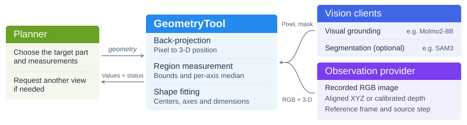

.. _geometry-toolkit:

几何工具包
==========

``GeometryTool`` 是一个通用的几何感知工具。主规划器通过 ``geometry`` 描述要测的物体和部位，工具从指定步骤已记录的标定观测中计算位置、方向或尺寸。

设计目的
--------

规划机器人动作时，主规划器可能需要知道目标部位的位置、朝向或尺寸。表面上一点的位置可以从三维观测中直接读取，而部位的中心、轴线或半径通常需要根据边缘或曲面上的多个点来估计。`GeometryTool` 为不同机器人程序提供统一的测量接口。主规划器描述要测的目标和所需的几何量，工具先读指定相机，必要时结合该步骤已记录的其他标定视角，返回可确认的测量值和缺失原因。

.. _geometry-module-design:

模块设计
--------

主规划器调用 ``geometry`` 时，用 ``query`` 描述目标，用 ``camera`` 指定相机。工具读取这台相机的一帧已记录观测，依次定位测量所需的部位。视觉模型在彩色图像中选出部位上的一个像素，工具通过反投影找到它在参考坐标系中的三维位置。

先识别整物体的模式会核验目标身份，再返回表面点。工具可以通过 RGB-D 确定目标区域，也可以用注入的 SAM3 提取候选区域或特定部位。区域内的有效三维点用于计算可见范围或拟合形状。已有视角仍无法确认目标时，由主规划器选择下一步任务动作。

.. _geometry-prompt-design:

选点提示
~~~~~~~~

主规划器的 ``query`` 应通过外观和空间关系指定唯一的物体，并说明要测的部位。请求拟合量时，工具会补充该量对应的部位描述，例如罐顶面或杯子内口沿，再交给 Molmo2-8B 选点。

Molmo 服务的 ``geometry`` 模式要求选择指定部位上的一个可见材质点：杯口选口沿材料，罐盖选顶面，不能用空心中心、内腔底面或侧壁代替。模型只负责二维选点，几何中心和尺寸由后续计算得到。目标或部位不可见、无法区分相似实例时，模型应回答未找到；工具不继续读取该点的三维坐标或调用分割器，该部位的结果保持未知。所有请求都未能得到结果时，返回 ``insufficient_evidence``。

服务将 Molmo2 的 0–1000 坐标按原始图像宽、高转换为像素 ``(col, row)``，并将图像右、下边界限制在最后一个像素。工具再转换为数组使用的 ``[row, col]``，检查原图分辨率后读取三维观测。没有可解析的单个选点时不产生坐标。Flash 使用独立的默认操作选点提示。

.. _processing-flow:

选择测量方式
~~~~~~~~~~~~

``measurement`` 默认为 ``surface_point``，工具通过 ``world_xyz`` 返回目标表面一个可见点的三维坐标。设为 ``visible_region`` 时，``visible_bounds_xyz`` 给出可见区域内有效三维点在各轴上的取值范围，``world_xyz`` 给出各轴的中位数。要测量某个部位的中心、朝向或尺寸，可以用 ``required_geometry`` 指定 1 到 10 个几何量，工具根据三维点拟合形状，并将结果逐项写入 ``geometry``。

.. list-table:: 不同物体的测量方法
   :header-rows: 1
   :widths: 16 44 40

   * - 对象
     - 需要的观测
     - 测量方法与结果
   * - 任意物体
     - 表面上有一个清晰可见、带有效三维坐标的点。
     - ``surface_point`` 直接返回该点的三维位置。
   * - 方块
     - 顶面的四条边和四个角附近都有三维点。还需提供相机位姿，以判断边缘是否被遮挡。
     - 请求 ``rectangle_center``，工具拟合矩形并返回顶面中心。
   * - 圆口杯
     - 能看到足够长的一段杯沿，边缘上有有效的三维点。
     - 用杯沿上的点拟合圆。``rim_center`` 返回杯口中心，``rim_radius`` 返回杯口半径。

.. _request-and-result-contract:

测一只杯子的尺寸
~~~~~~~~~~~~~~~~

假设桌上放着一只圆口杯，我们想知道杯口有多宽、杯子有多高。杯口直径可以由半径算出，因此主规划器请求杯口半径 ``rim_radius`` 和杯高 ``height``。本例中的相机名为 ``table_camera``。省略 ``step`` 时，默认值 ``-1`` 表示读取这台相机最近记录的一帧。

.. code-block:: json

   {
     "query": "the cup on the table",
     "camera": "table_camera",
     "required_geometry": [
       "rim_radius",
       "height"
     ]
   }

.. list-table::
   :header-rows: 1
   :widths: 20 43 37

   * - 请求量
     - 这一帧需要看到什么
     - 能返回什么
   * - ``rim_radius``
     - 一段足够长的圆形杯沿，边缘上有有效的三维点。
     - 拟合圆的半径，单位为米。``radius`` 是同一个量的另一个名称。
   * - ``height``
     - 杯口和杯底的边缘各能拟合出一个圆，两端分开且共轴。若杯壁也能拟合，它须与两端共轴，且可见部分位于两端之间。
     - 两个圆心之间的距离，单位为米。

假设从上方只能看清杯沿，拟合出的半径约为 4 厘米。下面是这个情形下的示例返回片段。

.. code-block:: json

   {
     "status": "partial",
     "geometry": {
       "rim_radius": {
         "value": 0.04,
         "unit": "m",
         "evidence_status": "inferred"
       },
       "height": {
         "value": null,
         "evidence_status": "unknown",
         "reason": "both_consistent_end_boundaries_required"
       }
     }
   }

这里的 ``partial`` 表示两项测量中只有一项有值。半径乘以 2，得到杯口直径约 8 厘米。杯高仍是 ``null``，原因是这一帧缺少可与杯口配对的杯底边缘。即使所有字段都有估计值，也需逐项检查 ``fit_accepted`` 和 ``warnings``。已有视角都无法提供所请求的测量时，主规划器收到 ``insufficient_evidence``。

直接从表面点或可见区域得到的结果标为 ``measured``，拟合值标为 ``inferred``。读取拟合结果时，``definition`` 和 ``unit`` 说明数值的含义和单位，``world_frame_id`` 和 ``source_step`` 标明参考坐标系和观测步骤。``assumptions`` 和 ``quality`` 记录拟合所用的假设及检查结果。``source_parts`` 列出用到的部位，``source_refs`` 可找到保存在共享 ``EnvState`` 原步骤下的掩码、三维点和拟合记录。

.. _observation-contract:

相机需要提供什么数据
~~~~~~~~~~~~~~~~~~~~

机器人程序通过 ``ObservationProvider`` 的 ``get_observation(*, camera, step)`` 提供一份 ``GeometryObservation``。相机名由接入程序定义，解析后的 ``step`` 对应共享 ``EnvState`` 中已有的一条记录，``world_frame_id`` 应始终指向同一个参考坐标系。

每帧都需要原始分辨率的 RGB 图像（``rgb``，形状为 H × W × 3，类型为 ``uint8``），并至少通过下列一种方式提供与图像对齐的三维数据。

- 有三维坐标图时，提供 ``world_xyz``。它的形状为 H × W × 3，每个像素保存参考坐标系中的三维位置，单位为米。
- 有深度图时，提供沿相机光轴的米制深度 ``depth_m``、3 × 3 针孔相机内参 ``intrinsics`` 和 4 × 4 刚体变换 ``camera_to_world``。工具据此将像素转换为三维坐标。相机的正 Z 轴朝前，参考坐标系的方向由接入程序定义。

查询像素的三维位置时，LIBERO、RoboDojo 和 Franka 使用 ``back_project``，RoboCasa365 使用 ``back_project_batch``，RoboTwin 使用 ``sample_world_xyz``。接入 ``GeometryTool`` 时，机器人程序通过 ``ObservationProvider`` 提供整帧 RGB 图像和表中对应的数据。

.. list-table:: 不同平台的三维数据来源
   :header-rows: 1
   :widths: 23 38 39

   * - 平台
     - 三维数据来源
     - 如何提供给几何工具
   * - MuJoCo / :doc:`LIBERO <../simulators/libero>` 和 :doc:`RoboCasa365 <../simulators/robocasa>`
     - 两个环境都使用 robosuite，按相机和步骤记录世界坐标图。
     - 选择与 RGB 图像对齐、分辨率相同的坐标图作为 ``world_xyz``。
   * - SAPIEN / :doc:`RoboTwin <../simulators/robotwin>`
     - RoboTwin 用相机内参和位姿，将以米为单位的深度图转换为世界坐标图。
     - 将同一相机、同一步骤的坐标图作为 ``world_xyz``，对应的深度图可作为 ``depth_m``。
   * - Isaac Sim / :doc:`RoboDojo <../simulators/robodojo>`
     - RoboDojo 根据头部或腕部相机的深度和标定参数生成世界坐标图。
     - 读取该相机在同一步骤的 ``world_xyz``，也可一并提供深度图 ``depth_m``。
   * - 真机 / :doc:`Franka <../real_world_robots/franka>`
     - 与 RGB 对齐的深度图和相机标定参数。腕部相机还需要拍摄时的机械臂末端位姿。
     - 提供 ``depth_m``、``intrinsics`` 和相机到机械臂基座的变换 ``camera_to_world``。

.. dropdown:: 有效点和可选的观测数据

   观测数组会复制为只读快照。有效点的坐标必须有限。如果提供了深度，或者可以根据相机位姿求出光轴深度，深度还必须有限且为正。同时提供深度图和坐标图时也会检查深度。可选的布尔掩码 ``valid_mask`` 可进一步排除无效像素，参考坐标系原点处的点也按相同规则判断。

   相机位姿有助于确定平面法向的朝向。清理口沿或侧壁的三维点时，提供参考坐标系中的上方向 ``up_direction`` 后，工具才会尝试识别并移除背景平面。可用 ``source_refs`` 记录这帧观测的来源。

.. _responsibilities-and-initialization:

在机器人程序中注册工具
~~~~~~~~~~~~~~~~~~~~~~

先准备共享的 ``EnvState``、观测提供方，以及在工具外初始化的 ``MolmoClient``。先识别整物体时，用 ``LocalPointAgent`` 包装 ``native`` 选点模式的客户端，通过 ``grounder`` 注入。Molmo 服务从 ``MOLMO_CHECKPOINT_PATH`` 加载已有的 Molmo2-8B 权重，提供选点和身份复核。按部位直接选点的评估路径使用单独的 ``geometry`` 选点模式。

通过 ``segmenter`` 注入机器人程序已连接的 SAM3 客户端，可为部位提取掩膜，也可在深度区域不足时重试。配置 ``region_source="depth"`` 时，经过身份核验的 RGB-D 区域本身可以支持表面点、可见范围和整物体测量。依赖分割器的部位在缺少分割器时保持未知。

下面的代码在已有的 ``toolkit`` 中注册实例的 ``geometry`` 方法，并在分发请求时绑定取消检查。

.. code-block:: python

   from functools import partial

   from rpent.robots.components.molmo_client import MolmoClient
   from rpent.utils.rpc import make_rpc_client
   from toolkits.geometry.geometry_tool import GeometryTool
   from toolkits.geometry.local_point_agent import LocalPointAgent

   grounder = LocalPointAgent(
       MolmoClient(make_rpc_client(molmo_endpoint), point_mode="native")
   )
   geometry_tool = GeometryTool(
       state=state,
       observations=observations,
       grounder=grounder,
       segmenter=segmenter,
       region_source="depth",
       segment_fallback=segmenter is not None,
       model="Molmo2-8B",
   )
   geometry = geometry_tool.geometry
   toolkit.add_tool(
       geometry.with_handler(
           partial(geometry, check_cancelled=toolkit.raise_if_cancelled)
       )
   )

工具集的注册和分发机制见 :doc:`interfaces`。

使用边界与运行验证
------------------

遮挡、深度缺失或分割区域混入其他表面，都可能使测量值保持未知。比较两帧的结果前，先确认目标、部位定义和参考坐标系一致。物体移动后应重新测量。把多个视角合成完整物体或内腔的三维模型需要额外的重建步骤。拟合残差反映观测点与所选形状的吻合程度，真实测量误差需要用独立的测量结果验证。

读取观测、调用模型或保存记录时发生错误，工具返回 ``status="error"``。如果请求缺少必填参数 ``camera``，工具集会在调用前返回含 ``error`` 和 ``errors`` 的参数错误。

安装测试依赖后，在仓库根目录运行离线检查。

.. code-block:: bash

   python -m pytest tests/unit_tests/toolkits/geometry \
     tests/unit_tests/rpent/robots/components/test_molmo.py -q

这些检查使用合成观测和替代模型服务，覆盖工具分发、坐标转换、分割重试、取消和部位拟合。

.. _geometry-libero-evaluation:

LIBERO 几何评估
---------------

独立评估入口 ``python -m toolkits.geometry.evaluation.experiment`` 覆盖 80 组、160 次目标部位测量，仅比较 ``agentview`` 起始帧。程序依次采集观测、调用 GeometryTool、用固定模型参考点和同帧物体姿态计算参考坐标，再统计三维欧氏距离误差；不执行机器人动作或补充视角，也不改变原有 LIBERO 运行流程。

``collect``、``build-truth``、``infer`` 和 ``evaluate`` 分别用于采集、生成参考点、推理和误差评估，阶段参数可通过 ``--help`` 查看。实时实验需要 LIBERO Pro、渲染环境及已有的 Molmo2-8B、SAM3 服务；``infer`` 通过 ``--molmo-endpoint`` 和 ``--sam3-endpoint`` 连接服务，在工具外初始化并注入客户端。``infer --replay`` 可复用冻结的选点和掩码，不连接模型服务。

``collect`` 保存评估输入所需的 RGB-D、标定和独立参考快照。``infer`` 默认只保留逐项预测 ``results.jsonl`` 和运行信息 ``run_manifest.json``，工具的临时诊断文件会在每组测量结束后清除。需要检查点云、掩码、叠图或记录感知结果以供回放时，添加 ``infer --save-evidence``；该选项将详细产物保存在各组目录中，实时选点和分割记录保存在 ``perception/``，供后续 ``infer --replay`` 使用。

本次基准使用与提交 ``699fa46`` 相同的 GeometryTool 源码，回放冻结的 ``step 0 / agentview`` RGB-D、视觉选点和 SAM3 掩码，重新执行全部 80 组、160 项测量；未拼接旧预测坐标，也未重新推理视觉模型。

下列结果属于该冻结输入基准，不是 Molmo2-8B 重新选点后的评估结果。

本评估每次请求一个部位中心。算出坐标但未通过质量检查时，结果为 ``status="warning"``，字段 ``fit_accepted=false``，并通过 ``warnings`` 记录物理边界未认证、锚点不一致等原因。原质量阈值保持不变，无法形成有效估计时仍返回 ``null``。带 warning 的坐标参与误差比较，但不代表已通过质量检查或具有经过标定的误差范围。

.. list-table:: 冻结输入位置误差
   :header-rows: 1

   * - 分组
     - 返回数 / 总请求
     - 均值（mm）
     - 中位数（mm）
     - 最大值（mm）
   * - 全部
     - 160/160
     - 21.329
     - 2.453
     - 378.348
   * - 通过检查
     - 18/160
     - 2.233
     - 2.342
     - 3.143
   * - 带 warning
     - 142/160
     - 23.749
     - 2.498
     - 378.348

误差只统计有参考点且返回坐标的项，未返回、失败和未运行项保留在返回率统计中。

采集数据、预测和生成的报告应保存在源码仓库外。完成采集、参考点生成和推理后，将 ``GEOMETRY_RUN_DIR`` 设为该实验目录，再从仓库根目录运行评估：

.. code-block:: bash

   export GEOMETRY_RUN_DIR="$HOME/rpent-runs/geometry-evaluation"
   python -m toolkits.geometry.evaluation.experiment evaluate \
     --predictions "$GEOMETRY_RUN_DIR/predictions/results.jsonl" \
     --truth "$GEOMETRY_RUN_DIR/truth.json" \
     --output "$GEOMETRY_RUN_DIR/report"

``evaluate`` 只生成一份简要的 ``report.md``，列出坐标返回率、整体与质量分组的误差均值、中位数和最大值，以及各目标部位的统计和数据来源。逐项预测仍保存在输入的 ``results.jsonl`` 中。输出目录须不存在或为空。

本地整物体 RGB-D 测量（实验副本）
---------------------------------

将配置为 ``point_mode="native"`` 的本地 ``MolmoClient`` 传给
``LocalPointAgent``，再注入 ``GeometryTool``。注入该 Agent 后默认启用整物体选点。
Pydantic AI 校验本地 Molmo 输出的像素和图像尺寸，全程可离线运行。
调用方提供米制标定观测和向上方向。``geometry`` 根据像素附近的支撑平面和
深度连通区域提取物体。``region_source="depth"`` 可以独立运行，混合模式还可使用
注入的 SAM3 掩膜和锚点附近的连通平面。

``rim_extrema`` 按相机的左、右、近、远顺序返回拟合内杯口圆上的点。
``top_corners`` 按远左、远右、近左、近右顺序返回顶面四角。
``top_size`` 给出长边和短边。``object_height`` 给出沿向上方向的可见高度。
``supported_height`` 在观测到支撑面及接触区域时估计完整竖直高度。
``height_above_support`` 给出从邻近支撑面到最高可见表面的竖直距离，物体悬空时该距离包含下方间隙。
矩形测量使用实际观测到的顶边和相连的侧壁。若侧壁能补足被画面裁掉的边界，
工具可以估计中心。输出两条完整边长或四角还要求看清两个方向的端点。
若相机几乎正对顶面对角线，两角的远近差小于采样精度，工具会保留可测的中心和边长，
并将有顺序要求的角点记为未知。

对有明确明暗描述的目标，紧邻候选的亮度分布足够分离时可据此区分。
``cuboid_corners`` 依次返回直立长方体的上层四角和相对应的下层四角。
下层四角根据已观测的接触支撑面和竖直侧壁假设推算，缺少底部接触证据时保留缺失。
对指定了单一彩色的方块或盒子，工具会比较全图的候选色块，测量顶面轮廓并检查边界内外的深度。
立方体还要求顶面两边的长度接近。多个盒子同时满足描述时，工具会请求新观测。
遮挡物后面若还有一片独立的同色材质，即使其深度样本已不足以拟合第二个方块，也可能无法确认目标唯一。

输出测量值前，本地 Molmo 会同时查看待测区域的材质像素和原图中同一位置的局部视图。
可见细节不足、物体身份存疑或多个实例无法区分时，工具可返回 ``insufficient_evidence``。
工具说明缺少的证据，由主 Planner 选择下一步。表面点、区域坐标和拟合量
都经过这项检查。表面点取自已核实的区域。被遮挡的方块有时仍能测到材质点，但完整顶面可能无法确定。

对于简短的类别名称，模型还要在不知道请求名称的情况下辨认孤立的材质区域。仅以外观描述时，无提示命名须支持物体类别，孤立材质也须符合所述外观。对分辨率足够但
无法命名的区域，可以加入少量原始背景再辨认，并在孤立材质上重新指点。名称冲突时请求新观测。
对于局部遮挡的彩色方块，深度数据须支持一个平侧面。模型还要在孤立图上重新指点，
映射回原图后确实落在测量区域内，才返回表面坐标。

查询描述多色包装时，本地模型直接读取测量区域上的品名，读图时不提供目标名称。
对敞口容器，杯口内侧的深度还须支持实际空腔。若另一个外观相近的容器也有可见空腔，
仅凭笼统的描述可能无法确定目标。推理输入包括标定 RGB-D、向上方向、
目标描述和请求字段。物体尺寸、位姿和参考模型供独立评分程序使用。

观测提供方可通过 ``additional_observations(primary)`` 提供同一步、同一世界坐标系下已标定的其他相机。
请求最新步骤时，工具先固定步号。首视角未能确认所需测量时才检查其他相机。
工具根据目标描述自行选择首视角的像素。一个视角的实测表面投影到另一视角后，若和该处深度一致，
工具就用它引导查找，并在新视角重新核验目标身份。只有实测材质重叠时才合并不同视角的字段。
方向点按首相机坐标轴排序，每个量记录实际来源相机和步骤。
对于“盘子和小烤碗之间的碗”，工具在场景中检查位置关系，在单独的材质图中核对碗的身份。

实时评估支持本地 Molmo RPC 和 Apple Silicon 的 MLX 权重。
可用 ``--first-view-only`` 单独评估首视角。

.. code-block:: bash

   python -m toolkits.geometry.evaluation.experiment infer \
       --inputs "$GEOMETRY_INPUTS" --output "$GEOMETRY_OUTPUT/live" \
       --mlx-checkpoint "$MOLMO_MLX_PATH" --save-evidence

用 ``toolkits.geometry.evaluation.stage_sensors`` 生成本地选点记录后，
可在原始相机观测上重放工具。例如：

.. code-block:: bash

   python -m toolkits.geometry.evaluation.local_experiment \
       "$GEOMETRY_INPUTS" "$GEOMETRY_OUTPUT/visual.sqlite" \
       "$GEOMETRY_OUTPUT/centers.jsonl" --region depth --extra-features \
       --identity-replay "$GEOMETRY_OUTPUT/live/perception"

选点记录保留实际模型输出和输入图像哈希。回放目录中的身份复核记录还绑定候选图像和提示。
只有旧选点记录时，工具缺少身份复核证据。评分程序在推理结束后读取独立真值。

Apple Silicon 可注入加载本地 Molmo2 权重的 ``MlxMolmoGrounder``，评估时也可传入
``--backend mlx``，并记录模型的量化精度。可选的 ``RefinedGrounder`` 在第一次选点周围
裁出原图一半宽、一半高的窗口，调用同一模型复看并把像素换回原图坐标。
评估选项 ``--refine-from`` 保存前后两次选点及裁剪框。首次未选出点时返回未知。
可将复看器的 ``confirm`` 方法注入 ``point_refiner``，只在多个深度区域紧邻时复看。
离线实验的对应选项为 ``--confirm-with``。

LIBERO 同步观测与抓放
~~~~~~~~~~~~~~~~~~~~~

启用 ``--geometry --molmo-endpoint "$MOLMO_ENDPOINT"`` 后，LIBERO 提供指定步骤记录的固定相机和腕部相机。
Planner 能看到已检查的相机及缺失证据，可以改用其他任务策略，也可以在任务动作改变场景后重新定位。

下例适用于矩形包装或直立罐体，使用已启动的 LIBERO 环境与 Molmo 服务。
输出指向源码树外的新目录。这个独立抓放实验为本地 Pydantic AI 策略额外注册 ``inspection_pose`` 。
它读取每次工具返回，最多补拍四次，仍无法确认中心就停止。
确认后从上方接近目标，夹取抬升，检查夹爪开度，并在测得的篮口上方释放，以环境原生终止信号判断任务结果。
独立评估另行检查双指是否接触指定物体、目标是否持续抬起、松爪后是否留在篮内。

.. code-block:: bash

   python -m robots.libero.geometry_pick_place \
       --env-endpoint "$LIBERO_ENDPOINT" --molmo-endpoint "$MOLMO_ENDPOINT" \
       --sam3-endpoint "$SAM3_ENDPOINT" \
       --target "the blue-and-white rectangular cream cheese box" \
       --quantity rectangle_center --output "$GEOMETRY_OUTPUT/pick-place-1"

目标和篮子描述须与启动的环境任务一致。可选的 ``--sam3-endpoint`` 为部位拟合和深度分割失败后的重试提供掩膜。
省略时，这个独立实验使用 RGB-D 几何模式。设置 ``--max-inspections 0`` 可限定为仅使用已记录的视角，沿用相同的抓放策略。
如果为确认篮口而移动了腕部，策略会在新的场景中重新定位待抓物，然后才闭合夹爪。待抓物和篮口共用同一补拍次数上限。

API Planner 默认使用通用的 ``back_project`` 和 ``segment``，由机器人程序提供观测并注册，
保留标定预览和按任务选择记忆的方式。
通过 ``--geometry --molmo-endpoint "$MOLMO_ENDPOINT"`` 可额外启用并列的只读工具 ``geometry``。
调用 ``geometry`` 时通过 ``query`` 描述目标，指定 ``camera``，可选的 ``step`` 默认为最新记录。
``measurement`` 指定表面点或可见区域，``required_geometry`` 可一次列出同一目标的部位和整物体测量项，
例如 ``["rim_center", "object_height"]``。工具在内部用本地模型选点，结合 SAM3 和标定 RGB-D
核实身份、测量目标，返回通过检查的字段、警告及证据引用。
状态为 ``insufficient_evidence`` 时只报告原因，主 Planner 自主选择下一步；
部分可测时保留已确认的量。
普通点或区域测量中，深度分割失败时可由 SAM3 提供候选掩膜，再执行身份检查。

测支撑面或间隙时，调用 ``back_project``，指定相机、步号，在 ``selection`` 中传入完整画面的 ``image_shape`` （高、宽）
和 ``points_rc`` （行、列列表）或 ``box_rc`` （上、左、下、右，下界和右界不含）。
点集和选区框都支持 ``height_m`` 闭区间，以世界坐标系原点为起点，沿观测提供的单位向上方向计算高度，单位为米。
该工具直接读取标定数据。批量采样按输入顺序返回，深度无效或高度超出区间的点标为 null。区域测量返回实际表面点和有效样本的边界。
``sampled`` 仅表示测到了所选表面，目标身份须由具名测量确认。
标定预览标出自身尺寸 ``image_shape``、原图名称及尺寸 ``full_image_shape``。
同一选区中的像素须来自同一幅图，越界时工具会给出允许范围。同一步重复相同语义测量可以复用已记录的证据。

需要已记录画面中的候选轮廓时，调用 ``segment``，指定相机，可提供文字描述、一个正像素点（行、列），也可同时提供两者。
同时提供时，工具用该点核对分数最高的文字掩膜。没有掩膜或掩膜未覆盖该点时返回 ``need_observation``，不返回坐标。
在缩放预览上选点时传入其 ``image_shape`` （高、宽）。纯文字模式可附带该尺寸。工具返回分数、掩膜和叠加图的引用。
掩膜内至少有十个有效深度样本时，还会返回观测坐标系下各轴的中位数，单位为米。这个点描述掩膜覆盖区域，
目标身份仍须核实。各机器人负责提供观测、模型客户端和证据存储。``geometry`` 拟合部位时复用
``segment`` 的掩膜和证据记录实现。
